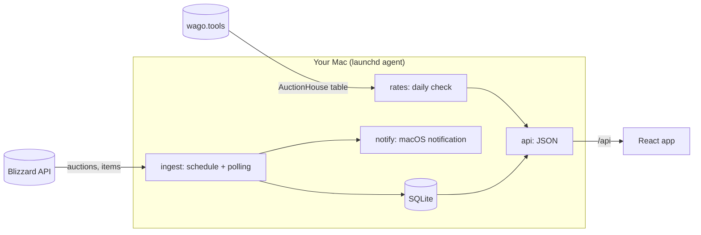

# Design specification

How the system is built and why. For *what* it does see the [functional specification](functional-specification.md);
requirement IDs (FR-x.y) refer to it. Keep this file in step with the code and add an entry to the
[decision log](#7-decision-log) when a design choice is made or changed.

## 1. Overview

A Go daemon collects WoW Forever auction data from Blizzard's API every hour into SQLite and serves a small JSON API.
A React app reads that API. Nothing else is involved except two read-only outside sources: Blizzard, and wago.tools
for the game's fee table.



## 2. Repository layout

```
backend/                Go module (go 1.18, standard library + a pure-Go SQLite driver)
  cmd/server/           wiring: config, store, ingest, notifier, rates, API
  internal/
    blizzard/           API client: OAuth, conditional GET, rulesets, houses, items
    poller/             pure functions: reduce listings to stats; estimate sales between snapshots
    store/              SQLite persistence and queries
    ingest/             polling, schedule, merging documents, flows, update events
    insights/           pure functions: buy/sell advice and the demand reading
    rates/              cut and deposit rates from the client tables, checked daily
    notify/             message text, batching, macOS notification
    api/                HTTP handlers
    config/             environment variables and constants
  scripts/              launchd install, uninstall and runner
frontend/               React + TypeScript + Vite
  src/                  App, PriceChart, InsightsPanel, helpers, tests
docs/                   these specifications
```

Dependencies point inwards: `poller` and `blizzard` know nothing of storage; `store` knows `poller`; `ingest` ties
`blizzard`, `poller` and `store` together; `insights` is pure; `api` composes `store`, `insights` and `rates`;
`notify` knows only the `ingest.Update` event.

## 3. External interfaces

### 3.1 Blizzard Game Data API (`dynamic-forever-<region>` and `static-forever-<region>`)

Authentication: OAuth client credentials; the token is cached and refreshed on a 401. Namespaces are given as a query
parameter. Conditional requests use `If-Modified-Since` and `Last-Modified` (304 when unchanged).

| Endpoint | Used for |
|---|---|
| `/data/wow/ruleset/index`, `/ruleset/{id}` | the rulesets and their names |
| `/data/wow/ruleset/{id}/auctions/{house}` | a house's regular listings (`buyout` is a total) |
| `/data/wow/ruleset/{id}/auctions/{house}/commodities` | a house's stackable listings (`unit_price`) |
| `/data/wow/item/{id}` (static) | name, vendor `sell_price`, item class (category). Asked **without** `locale`, so `name` and `item_class.name` come back as objects keyed by locale: one request carries English (`en_GB`) and Spanish (`es_ES`, else `es_MX`). |
| `/data/wow/media/item/{id}` (static) | icon URL |

Facts that shaped the design (found by probing and from Blizzard's docs):

- Forever has **no realms** and no connected realms. Houses are reached through rulesets, but the ruleset in the URL
  does **not** select the data: the same house ID returns the same listings under every ruleset. The house ID is what
  matters.
- Houses 112, 115 and 118 are empty. The ruleset of a house is not stated anywhere; see decision D-3.
- Listings carry their own `id` and a `time_left` bucket (SHORT, MEDIUM, LONG, VERY_LONG), which is what makes the
  sales estimate possible. Blizzard publishes **no sales and no buyers**.
- Auction data is published once an hour at about 22 past, in a burst: Blackwater first, Alliance and Horde 8–12
  seconds later. Blizzard says the interval may change.

### 3.2 wago.tools

`/api/builds` (newest `wowf` build) and `/db2/AuctionHouse/csv?build=…` give the game's `AuctionHouse` table:
`ConsignmentRate` (the cut) and `DepositRate` per house. Two requests a day, with a descriptive User-Agent. At build
1.60.1.71037: cut 5 (faction) / 15 (Blackwater); deposit rate 5 / 25.

## 4. Data model (SQLite, `backend/data/wow.db` or the daemon's own folder)

| Table | Key | Content |
|---|---|---|
| `snapshots` | (realm_id = house id, item_id, ts) | `min`, `median`, `avg`, `quantity` per item and moment; `ts` is Blizzard's publication time (unix seconds). Index on `ts`. |
| `items` | id | `name`, `icon`, `vendor_sell`, `class_id`, `class_name`, `name_es`, `class_name_es`. NULL means not fetched yet (for `name_es`: named before Spanish existed, so `FillSpanishNames` backfills it); `icon` "" and `class_id` -1 mean fetched and absent. |
| `item_kinds` | item_id | `commodity` 1/0, set from the document the item was listed in. |
| `flows` | (house_id, item_id, ts) | `sold_low`, `sold_high`, `sales`, `listed`. Index on `ts`. |

- The column `realm_id` of `snapshots` holds the **house ID**; for historical reasons of the schema it keeps its name.
- Prices are integers in copper. Retention deletes `snapshots` and `flows` older than the retention period.
- Schema changes are additive: `addColumn` upgrades existing databases, and "NULL = not fetched yet" makes the
  background look-up queue back-fill them automatically.
- Single connection (`SetMaxOpenConns(1)`): one writer is enough and avoids lock errors.

## 5. Components

### 5.1 `ingest`: polling and schedule (FR-1.*, FR-7.4/7.5)

- `Realm` = a ruleset with its `House`s (ID + faction). `ResolveRealms` lists the rulesets and attaches the houses
  from `config.ForeverHouses`; unknown rulesets are skipped, none usable is an error.
- `PollRealm` polls every house, independently. For a house: conditional request for the regular document; if
  unchanged, stop (the commodity document is not downloaded); otherwise download commodities too, merge, `Reduce`,
  store the snapshot and item kinds, then compute and store flows. A 404 on every house of a ruleset means "no data":
  the ruleset is skipped for an hour (`ErrNoAuctionData`).
- `Update` events: a house counts as updated only if its snapshot moment was **not already stored**
  (`HasSnapshot`) and it has items. This is why a restart does not notify.
- **Schedule** (`nextPoll`, a pure function): expected next publication = earliest "last published" among houses +
  1 hour. Far from it: wait the base interval or wake 10 s before it. Within 10 s before to 10 min after: poll every
  5 s. Later than that: base interval. Because it uses the **earliest** house, polling stays fast until the slowest
  house has the new hour.
- **Maintenance** (`maintain`) runs in its own goroutine: item names/icons/vendor prices/categories (500 per round,
  woken by new snapshots and every 5 minutes) and retention. It cannot delay a poll (decision D-6).
- The previous snapshot of each house is kept **in memory** to compute flows; a restart skips one comparison.

### 5.2 `poller`: pure statistics (FR-1.4, FR-2.7, FR-5.*)

**How money works.** The unit everywhere is the copper, as a whole number: 100 copper = 1 silver, 100 silver = 1 gold,
so 10,000 copper = 1 gold. Blizzard sends copper: a regular listing has a total `buyout` (in the live Forever houses
every one has quantity 1) and a commodity has a `unit_price`, which the client turns into a total so both read alike.
Every stored and served price is **per unit**. A character cannot hold more than 2^31-1 copper (214,748g 36s 47c), so
a price above that cannot be paid: in the live data real prices end near 210g at the 99.9th percentile, then there is
a gap, then placeholders at 33,333,333,333, 99,999,990,499 and 99,999,999,999 copper (the game's maximum buyout).

- `Buyable(auctions)` drops listings whose unit price is above `MaxUnitPrice` (2147483647). It runs once in
  `pollHouse`, before `Reduce` and before the flows are compared, so a parked listing is neither a price nor a sale.
  Listings without a buyout or quantity are kept for `Reduce` to ignore. `Cleanup` also deletes stored rows whose
  lowest price is above the cap (`Store.DeleteAbove`).

- `Reduce`: per item, unit price = buyout / quantity per listing; min; quantity-weighted median (first price at which
  the cumulative quantity reaches half); weighted average.
- `Flows(prev, cur, gap)`: index listings by ID. Vanished → `SoldHigh += qty`, `Sales++`; also `SoldLow += qty` if the
  listing's time-left floor (SHORT 0, MEDIUM 30 min, LONG 2 h, VERY_LONG 12 h) is **greater than** the gap. Shrunk
  stack → both estimates and `Sales++`. New ID → `Listed += qty`. Returns nil without a baseline or if the gap is not
  positive or exceeds 12 h.

### 5.3 `insights`: pure advice (FR-4.*, FR-5.4)

- `Compute(points, cut)`: market value = median of the hourly medians; percentile = share of the window priced above
  the current lowest; 1 and 7 day change against the last point at least that old; supply vs average; net at market =
  market × (1 − cut); break-even = lowest ÷ (1 − cut) rounded up; flip margin = net at market − lowest.
- Verdict constants: ≥ 24 points needed; buy: margin ≥ 10% and cheaper than ≥ 70%; sell: lowest ≥ 10% above market
  and cheaper than ≤ 30%.
- `Advise`: commodity → list price = lowest; otherwise → current median. Net = list × (1 − cut). `BelowVendor` when a
  known, positive vendor price exceeds that net. Deposits for 2/8/24 h = vendor × rate/100 × hours/2, minimum 1 c.
- `ComputeDemand(points, flows)` over the last 7 days: observed hours = sum of gaps ≤ 12 h between snapshots; per day
  = total × 24 / observed; days of supply = latest stock ÷ per-day (best and worst case); sell-through = mid
  per-day ÷ average stock; level thresholds 30% / 10%; "unknown" under 3 observed hours.

### 5.4 `rates` (FR-6.*)

`Table` holds `map[house]Rate` behind a mutex. `Refresh` picks the newest `wowf` build, parses the CSV (rows that do
not parse are skipped, a table without the columns is rejected) and swaps the map atomically, logging changes.
`Run` checks at start and every interval; a failure is logged and the old rates stay. The API asks the table first and
falls back to configuration (`rulesFor`).

### 5.5 `api`: JSON over HTTP (FR-2, 3, 4, 5, 7.1)

Every item endpoint takes `realm` = a **market (house) id**. Without it, the first house with data is used.

| Endpoint | Returns |
|---|---|
| `GET /api/realms` | rulesets with only their houses that have data: `[{id, name, houses:[{id, faction}]}]` |
| `GET /api/items?q=&realm=&category=&sort=&dir=&lang=` | up to 20 items by name; with only `category`, up to 50 most listed; 400 if neither. `sort=price` orders by the lowest buyout, highest first; `sort=sold-low` / `sort=sold-high` by the units sold (`flows.sold_low` / `sold_high`) in the last 7 days; highest first unless `dir=asc` (`dir=desc` is the default, anything else a 400); ties by name; any other `sort` is a 400. By price, items on sale in the latest snapshot always come before ones last seen earlier, in either direction. Every item carries `soldLow`/`soldHigh`, the sums of `flows` over that window. `lang=es` returns the Spanish name (English where there is none) and a typed name matches either language; `lang` other than `en`/`es` is a 400 |
| `GET /api/categories?realm=&lang=` | categories sold in the market, by name: `[{id, name, soldLow, soldHigh}]`, the units sold in each over the last 7 days; `lang=es` names them in Spanish (one entry per category even while only some items have a Spanish name) |
| `GET /api/items/{id}/history?realm=&days=` | snapshots (default 7 days, capped at retention) |
| `GET /api/items/{id}/insights?realm=` | insights, advice and the 7-day demand reading; 404 without prices |
| `GET /api/items/{id}/flow?realm=&days=` | the stored sales-volume rows |
| `GET /api/status?realm=` | `{updatedAt}`, the market's newest snapshot (null if none) |

Lists are never `null` (empty array), unknown markets are 400, and errors are plain text.

### 5.6 `notify` (FR-7.4–7.6)

`Format` builds the text; `Batcher` merges updates of one ruleset within 30 s into one (houses unique in order,
totals added); `MacOS` runs `osascript -e 'display notification …'` with the text escaped and passed as one argument,
never through a shell.

### 5.7 Frontend

- **State:** `App` owns the market (`realm` = house id), the search text, category, results, selected item, range, and
  the status. Data for the selected item is keyed (`id:market:days`) so stale data is never shown while a new one loads.
- **Search:** a 300 ms debounce, two-letter minimum, a sequence counter that discards late answers, and a key of
  `market|text|category|sort` so the Search button and the debounce never run the same search twice.
- **Address:** `?realm=&q=&category=&sort=&item=` is written with `replaceState` and read once at start.
- **Freshness:** a 30 s poll of `/api/status`; the first reading of a market is a baseline, a different `updatedAt`
  bumps a refresh counter that re-runs the history, insights and categories effects and a results refresh that
  replaces results without clearing them. Effects depend on the selected item's **id**, so a refresh neither refetches
  twice nor steals focus.
- **Chart:** hand-written SVG (no library): 480×260 viewBox, five time labels chosen by time (not by index) on real
  snapshots, a marker per snapshot up to 72, pointer and keyboard readout, text description for screen readers.
- **Money display:** `moneyParts` (in `format.ts`) is the single place that splits copper: it rounds to a whole copper
  first (so 99.6 is a silver, never "100c"), keeps the sign apart and returns nothing for NaN or infinity. `formatMoney`
  (text) and `Money` (with coins) both use it. Counts, percentages and decimals go through `formatCount`,
  `formatPercent` and `formatDecimal`, so Spanish gets its dots and commas.
- **Not on sale now:** the API's `current` flag (`snapshot ts = the market's latest`) drives the "Not listed now" tag, a
  muted price and the "Last price seen" label. `sort=price` orders `on_sale DESC` first. `ItemsMissingName` orders by
  `MAX(min × quantity) DESC`.
- **Results table:** a real `<table>`; the Price and Sold headers are buttons with `aria-sort` that cycle the `order`
  (`sort` of `price`, `sold-low`, `sold-high` or none, plus a `dir`) and so re-run the search. A column starts at
  `FIRST_DIR` (price `asc`, the sold columns `desc`), the second click reverses it and the third clears it; the
  address carries `sort` and, only for `asc`, `dir`. The arrow (▲ ascending, ▼ descending) is drawn by CSS.
- **Languages:** `i18n.ts` holds the English messages (the source of the `Key` type) and the Spanish ones
  (`Record<Key, string>`, so a missing translation does not compile), `translate` with `{name}` placeholders,
  `detectLang` and the saved choice (`localStorage` key `lang`, read with a fallback when storage is blocked).
  `i18nContext.ts` offers `useI18n()` (`lang`, `t`, and `tn`, which fills placeholders with elements such as a price);
  without a provider everything is English, so components work on their own. `App` owns the language and wraps `Page`
  in `I18nProvider`. `format.ts` takes the language for numbers, percentages, times and the coin letters. The requests
  carry `lang=es` only for Spanish, so English addresses are unchanged. A language change re-runs the categories and
  reloads the results in place (the search key leaves the language out, so it does not reset the selection).
  `LanguageSwitch` is a labelled group of two `aria-pressed` buttons named in their own language (no flags); clicks
  on it do not count as outside clicks for the details panel.
- **Home:** the title is an `<a href="/">` whose click handler clears query, category, sort, results and selection
  (`clearResults` also drops any search still in flight) and keeps the market.
- **Details panel:** `closeDetails` refocuses the open `.result` button, then clears the selection (which also drops
  `item` from the address); a window `keydown` listener for Escape and a document `pointerdown` listener (ignoring targets inside `.details`
  or `.result`, and not moving focus) are installed only while an item is selected. In the
  two-column layout the panel is `sticky` with `max-height: 100vh - 32px` and its own `overflow-y`.
- **Prices:** the `Money` component splits copper into g/s/c and draws a `.coin` span per part, with the unit letter in
  `sr-only` text. The coins are Blizzard's `inv_misc_coin_01/03/05` icons from `render.worldofwarcraft.com` (the host
  that already serves the item icons), as CSS backgrounds over a CSS-drawn coin that shows while they load or if they
  fail. Chart labels and sentences keep the plain text `formatMoney`.
- **Front page:** the empty state is a `hero` section (welcome plus category shortcuts ranked by units sold, each calling `setCategory`);
  the debounced search then browses it. It renders under the same condition as the old guidance text.
- **Look:** a World of Warcraft mood in plain CSS: dark stone with ember gold by default, parchment in light mode, a
  serif display face from the system stack. No Blizzard or WoW logos or typefaces are used or imitated: the emblem (`frontend/public/logo.svg`, a gavel on a
  gold coin, original vector art) is shown in the header and as the tab icon. The only Blizzard images are the item and
  coin icons it serves.
- **Styling:** one stylesheet, CSS variables, dark (default) and parchment light by `prefers-color-scheme`, 44 px targets, focus outlines,
  a two-column layout from 900 px.

## 6. Configuration (environment variables, `backend/.env`)

| Variable | Default | Meaning |
|---|---|---|
| `BLIZZARD_CLIENT_ID`, `BLIZZARD_CLIENT_SECRET` | required | Blizzard API client |
| `REGION` | `eu` | namespace and host region |
| `FOREVER_RULESETS` | `pvp` | `pvp,normal,roleplay,rp-pvp` |
| `POLL_INTERVAL` | `1m` | slowest polling rhythm (min 1 m) |
| `RETENTION_DAYS` | `30` | maximum 30 |
| `LIVE_RATES`, `RATES_INTERVAL` | `on`, `24h` | read the cut and deposit rate from the client tables (min 1 h) |
| `AH_CUT_PERCENT`, `AH_CUT_BLACKWATER_PERCENT` | `5`, `15` | fallbacks |
| `NOTIFICATIONS` | `on` | macOS notifications |
| `DB_PATH`, `ADDR` | `data/wow.db`, `:8080` | database file and listen address |

## 7. Decision log

| ID | Decision | Why |
|---|---|---|
| D-1 | **Forever only.** Earlier work on Classic Progression, Era and Anniversary was removed. | The user plays Forever; the others had no usable auction data (Era/Anniversary house documents answer 404, documented by Blizzard as "not yet published"). |
| D-2 | A **house is a market**, keyed by Blizzard's house ID; the UI picks a ruleset and a faction. | Forever has no realms; each house has its own prices and its own fee. |
| D-3 | The ruleset → house mapping is a **fixed table** in `config`. | Blizzard never says which house belongs to which ruleset. Inferred by matching live listings with a third-party tracker (item counts, Linen Cloth counts). Marked 🟡 in FR-1.12. |
| D-4 | **Read Blizzard's API only**; no scraping, no third-party price data. | Blizzard's terms forbid collecting data outside the API; third-party sites' data was used only to validate. |
| D-5 | **SQLite**, single connection, pure-Go driver. | One user, one writer, no server to run; the pure-Go driver needs no C toolchain and supports Go 1.18. |
| D-6 | **Maintenance separate from polling.** | Item look-ups are hundreds of requests; sharing a loop made a poll fall 7 s before Alliance and Horde published and wait 5 minutes. |
| D-7 | **Follow Blizzard's publication** instead of a fixed interval. | Hourly bursts with a few seconds of spread; the interval may change. A pure `nextPoll` keeps it testable. |
| D-8 | **Estimate sales from vanished listings** with a low and a high bound. | The API has no sales; `time_left` lets some disappearances be ruled out as expiry. Buyers cannot be known (FR-5.7). |
| D-9 | Previous snapshot kept **in memory**. | Persisting ~200,000 listings an hour is heavy; the cost is one skipped comparison per restart. |
| D-10 | Read the **cut and deposit rate from the client table**, daily, with configured fallbacks. | Blizzard's API does not expose them; the table does. A change is logged because it would silently change every margin. |
| D-11 | **Deposit is an estimate** and excluded from margins. | The Classic rule (vendor × rate per 2 h) is not confirmed for Forever. |
| D-12 | **Commodity vs single item** advice differs. | Commodities fill cheapest-first with newest-first ties, so matching the lowest beats undercutting; gear is priced against the wall of listings. |
| D-13 | **Hand-written SVG chart**, no chart library. | Few features needed, no dependency, easy to test in jsdom and to describe for screen readers. |
| D-14 | A **macOS notification through `osascript`**, batched for 30 s. | Nothing to install; houses publish seconds apart so one burst becomes one notification. |
| D-15 | **Test-first**, and a commit after each feature. | The tests are the executable specification; small commits keep the history readable. |
| D-16 | Daemon files live in `~/Library/Application Support`, not the project folder. | macOS does not let background agents read `~/Documents`. |

## 8. Security and legal

- The client secret lives only in `.env` (git-ignored, mode 600) and in the daemon's own folder; never in the repo.
- Collected data stays local; the database is git-ignored; retention is capped at 30 days (Blizzard's terms).
- The notification text is escaped and run without a shell; item names come from Blizzard and are never executed.
- The app shows the Blizzard attribution and a not-affiliated statement, is free, and has no advertising.

## 9. Testing strategy

- **Test-first:** every behaviour has a failing test before its code; tests describe features, never bent to pass.
- **Backend:** `go test -race ./...`. Pure packages (`poller`, `insights`) are tested on data; `blizzard`, `rates` on
  `httptest` servers; `store` and `ingest` on real temporary SQLite files with a fake Blizzard source; `api` through
  its handler. Time is injectable where it matters (`now`).
- **Frontend:** Vitest + Testing Library on jsdom with `fetch` replaced by an in-memory API. Timing-sensitive tests
  wait for the visible outcome instead of sleeping, and run several times in a row to catch flakiness.
- **Manual:** the daemon (launchd), the notification banner and the live Blizzard data cannot be automated; the
  README lists the checks.

## 10. Extension points and future work

| Idea | Where it would go |
|---|---|
| Other rulesets (Normal, Roleplay) | `FOREVER_RULESETS`; verify the house mapping in game first |
| Cross-faction price comparison (Alliance / Horde / Blackwater side by side) | `api` + a panel; data already stored per house |
| "Cost to buy N units" (needs the order book) | store per-listing prices or a price histogram per snapshot |
| Price alerts | `ingest.Update` is the hook; `notify` the sink |
| Time-of-day price pattern | needs a few weeks of history; `store` queries |
| Finer item categories (subclasses) | `ItemInfo` already receives the item doc |

## Revision history

| Date | Change |
|---|---|
| 2026-11-21 | First version, describing the system as built: Forever-only collection on Blizzard's schedule, SQLite model, insights, sales estimate, live fee rates, notifications, category browsing and the last-update refresh. |
